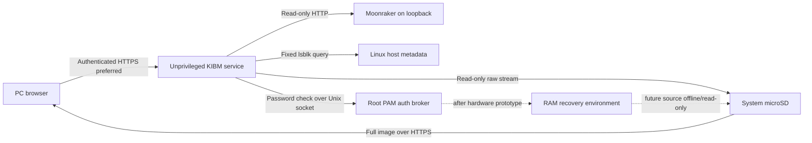

# Architecture and implementation phases

## Phase 1: architecture and safety analysis



### Components

1. **Normal-mode service** — unprivileged FastAPI process, dashboard, read-only host inspection, Moonraker state check, confirmation UI, authenticated sessions, and a read-only raw card stream.
2. **Privileged broker** — the root-owned local auth broker validates the invoking Pi user's existing password through PAM. The HTTP process remains unprivileged and cannot request arbitrary commands or paths.
3. **Recovery environment** — the plan-only `kibm-recovery` CLI validates an externally built initramfs and emits a candidate `tryboot.txt` bundle outside the boot directory. It does not build the initramfs, install files, or activate a reboot. The recovery environment itself is not implemented; it must provide networking and a status page while leaving the source root unmounted before it can be considered.
4. **Imaging engine** — reads the full `/dev/mmcblk0` device while the Pi is running and streams it uncompressed to the browser. It validates the card identity before reading and the printer state during the stream. The live filesystem can change during capture.
5. **PC receiver** — the browser receives an attachment and uses its normal save dialog. A full-size raw image is produced; shrinking and recovery remain future work.

### Pi 4 boot strategy

The Pi 4 uses an EEPROM second-stage bootloader. Raspberry Pi's documented `tryboot` mechanism sets a one-shot flag and loads `tryboot.txt` instead of `config.txt`; the flag is cleared before the alternate firmware starts. The next reset therefore selects the usual `config.txt` again. The candidate bundle preserves normal configuration and places a separate recovery command line and initramfs selection in `tryboot.txt`.

This is a plan, not a validated deployment recipe. Raspberry Pi documents `initramfs` loading as an advanced technique without an official build procedure. Secure Boot selects `tryboot.img` and is outside this plan. Pi 4 Model B revisions 1.0 and 1.1 require EEPROM write protection to be disabled for `tryboot`. Firmware/kernel compatibility, network startup, source-card state, crashes, resets, and power-loss behavior need hardware testing. No installer in this repository edits boot files or EEPROM state. If recovery hangs, automatic return is not guaranteed; physical access may be required.

Do not use `autoboot.txt` A/B partition selection as if it were a simple one-shot kernel selector: it selects boot partitions and robust A/B operation requires a dedicated partition layout. Do not write EEPROM configuration or OTP settings.

### State machine

Planned states and allowed forward edges:

```text
IDLE -> PREFLIGHT -> AWAITING_CONFIRMATION -> PREPARING_RECOVERY
     -> REBOOTING -> RECOVERY_READY -> BACKUP_RUNNING -> STREAMING
     -> VERIFYING -> COMPLETED -> RETURNING_TO_KLIPPER -> IDLE
```

The future recovery state machine is not implemented. The current image flow stops with a visible reason if the printer leaves standby, the card cannot be read, or the transfer fails. It does not change boot configuration or reboot.

### Image strategy

The current image is a raw copy of the complete source card and therefore requires a destination card at least as large as the source. Smaller-card images would require a future offline algorithm: identify the device and partition table, validate supported filesystems, shrink an offline ext filesystem, retain sector offsets and boot records, and validate all image boundaries. This workflow is not implemented.

Never shrink the mounted live root. Never run destructive tools against a source device until its identity and operation plan have been displayed and separately confirmed.

### Integration and API

The dashboard exposes read-only diagnosis endpoints. Backup preflight checks printer standby, the supported system card, and read permissions. Starting and downloading a backup requires a browser session validated against the existing Pi account. The unprivileged service streams the full raw image from `/dev/mmcblk0` to the browser over local HTTPS; it does not stage the image on the Pi. The card is read while the system is running, so file contents may change during capture. Moonraker state is queried through its local HTTP API. Mainsail/Fluidd source files are not edited. Recovery and shrinking remain future work.

### Verification plan

- Unit tests with mocked procfs, lsblk output, and Moonraker responses.
- API tests for session authentication, CSRF, unknown Moonraker state, and unavailable imaging features.
- Synthetic disk-image tests before any loop-device use; loop-device tests only in an explicitly isolated environment.
- Browser checks at desktop and mobile widths, including keyboard focus and console errors.
- Pi 4 hardware test matrix by board revision, bootloader/EEPROM state, OS release, 32/64-bit kernel, and power interruption.
- Separately record implementation, unit/API verification, hardware boot, actual restore, and boot-on-printer evidence. A digest is not proof of bootability.

## Current implementation in this branch

Read-only diagnostics, Pi account authentication with CSRF protection, local HTTPS, a dark responsive UI, storage/partition summaries, Moonraker safety classification, and full raw image streaming through an unprivileged systemd service. Recovery, shrinking, reboot, and restore remain unavailable.

## Raspberry Pi references

- [Raspberry Pi TRYBOOT one-shot flow and hardware limits](https://www.raspberrypi.com/documentation/computers/raspberry-pi.html#fail-safe-os-updates-tryboot)
- [Raspberry Pi boot configuration and initramfs syntax](https://www.raspberrypi.com/documentation/computers/config_txt.html)
- [Raspberry Pi boot files, EEPROM boot flow, and initramfs overview](https://www.raspberrypi.com/documentation/computers/configuration.html)
- [Raspberry Pi's official image generation tool](https://github.com/RPi-Distro/pi-gen)
