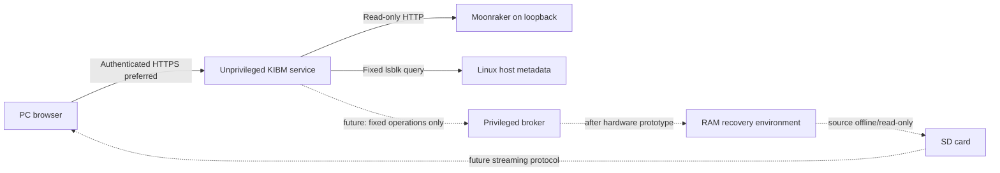

# Architecture and implementation phases

## Phase 1: architecture and safety analysis



### Components

1. **Normal-mode service** — unprivileged FastAPI process, dashboard, read-only host inspection, Moonraker state check, persistent state store (future), and user confirmation UI (future).
2. **Privileged broker** — not implemented. Any future root-only work must use a narrow, fixed-operation broker; the HTTP process must never run as root or accept arbitrary commands/paths.
3. **Recovery environment** — the plan-only `kibm-recovery` CLI validates an externally built initramfs and emits a candidate `tryboot.txt` bundle outside the boot directory. It does not build the initramfs, install files, or activate a reboot. The recovery environment itself is not implemented; it must provide networking and a status page while leaving the source root unmounted before it can be considered.
4. **Imaging engine** — not implemented. It will validate supported partition tables/filesystems before creating a block-level, bootable image. Shrinking must operate on an offline copy or reconstructed image, never mutate the live source root filesystem.
5. **PC receiver** — not implemented. A future protocol must acknowledge receipt and digest validation before allowing the Pi to return to normal mode.

### Pi 4 boot strategy

The Pi 4 uses an EEPROM second-stage bootloader. Raspberry Pi's documented `tryboot` mechanism sets a one-shot flag and loads `tryboot.txt` instead of `config.txt`; the flag is cleared before the alternate firmware starts. The next reset therefore selects the usual `config.txt` again. The candidate bundle preserves normal configuration and places a separate recovery command line and initramfs selection in `tryboot.txt`.

This is a plan, not a validated deployment recipe. Raspberry Pi documents `initramfs` loading as an advanced technique without an official build procedure. Secure Boot selects `tryboot.img` and is outside this plan. Pi 4 Model B revisions 1.0 and 1.1 require EEPROM write protection to be disabled for `tryboot`. Firmware/kernel compatibility, network startup, source-card state, crashes, resets, and power-loss behavior need hardware testing. No installer in this repository edits boot files or EEPROM state. If recovery hangs, automatic return is not guaranteed; physical access may be required.

Do not use `autoboot.txt` A/B partition selection as if it were a simple one-shot kernel selector: it selects boot partitions and robust A/B operation requires a dedicated partition layout. Do not write EEPROM configuration or OTP settings.

### State machine

Planned states and allowed forward edges:

```text
IDLE -> PREFLIGHT -> AWAITING_CONFIRMATION -> PREPARING_RECOVERY
     -> REBOOTING -> RECOVERY_READY -> BACKUP_RUNNING -> STREAMING
     -> VERIFYING -> COMPLETED -> RETURNING_TO_KLIPPER -> IDLE
```

Any failed check transitions to `ERROR` with a reason and no destructive action. An unknown printer state, active/paused print, unsupported partition map, mounted source filesystem, loss of client acknowledgement, or integrity failure blocks continuation. The state machine and persistent recovery journal are not implemented yet; there are currently no transition endpoints.

### Image strategy

Raw copying alone preserves a source card's full capacity and does not meet the smaller-card requirement. The planned offline algorithm is: identify the entire source device and partition table; reject unsupported layouts; verify ext4 offline; copy only after validation; shrink an offline ext filesystem to a measured minimum plus reserve; rewrite only the image's partition table while retaining sector offsets and boot records; validate boundaries, UUID/PARTUUID references, FAT boot data, and image size; then stream and hash the result. Exact tooling and supported layouts remain undecided until synthetic image fixtures prove the geometry and restore workflow.

Never shrink the mounted live root. Never run destructive tools against a source device until its identity and operation plan have been displayed and separately confirmed.

### Integration and API

Phase 2 currently exposes a read-only dashboard and `GET /api/system`, `GET /api/storage`, `GET /api/klipper/status`, and `GET /api/backup/preflight` endpoints without login. The preflight endpoint never says a backup is ready; it only reports current blockers and that backup is unavailable. Moonraker state is queried through its local HTTP API. Mainsail/Fluidd source files are not edited. A stable link/bookmark or supported configuration mechanism will be chosen after checking each frontend's current extension mechanism. Keep the unauthenticated dashboard on a trusted local network; future backup or write features need a separate access-control design.

### Verification plan

- Unit tests with mocked procfs, lsblk output, and Moonraker responses.
- API tests for session authentication, CSRF, unknown Moonraker state, and unavailable imaging features.
- Synthetic disk-image tests before any loop-device use; loop-device tests only in an explicitly isolated environment.
- Browser checks at desktop and mobile widths, including keyboard focus and console errors.
- Pi 4 hardware test matrix by board revision, bootloader/EEPROM state, OS release, 32/64-bit kernel, and power interruption.
- Separately record implementation, unit/API verification, hardware boot, actual restore, and boot-on-printer evidence. A digest is not proof of bootability.

## Phase 2 delivered in this branch

Read-only diagnostics, session login with CSRF protection, a dark responsive UI, storage/partition summaries, Moonraker safety classification, and an unprivileged systemd unit template. Imaging, reboot, recovery installation, and admin actions remain unavailable by design.

## Raspberry Pi references

- [Raspberry Pi TRYBOOT one-shot flow and hardware limits](https://www.raspberrypi.com/documentation/computers/raspberry-pi.html#fail-safe-os-updates-tryboot)
- [Raspberry Pi boot configuration and initramfs syntax](https://www.raspberrypi.com/documentation/computers/config_txt.html)
- [Raspberry Pi boot files, EEPROM boot flow, and initramfs overview](https://www.raspberrypi.com/documentation/computers/configuration.html)
- [Raspberry Pi's official image generation tool](https://github.com/RPi-Distro/pi-gen)
