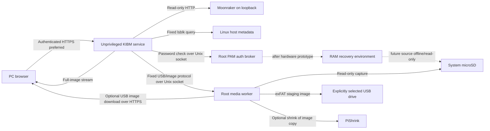

# Architecture and implementation phases

## Phase 1: architecture and safety analysis



### Components

1. **Normal-mode service** — unprivileged FastAPI process, dashboard, host inspection, Moonraker state check, confirmation UI, authenticated sessions, full-card browser streaming, and USB-job status/download proxying.
2. **PAM broker** — the root-owned local auth broker validates the invoking Pi user's existing password through PAM.
3. **Media worker** — a separate root-owned Unix-socket service accepts requests only from the `kibm` account. It rechecks the explicitly selected USB device, formats only that USB disk as exFAT, captures the full source image, verifies the staged file, and optionally runs PiShrink on a separate image copy. It does not accept shell commands or arbitrary filesystem paths. The running system microSD is only read.
4. **Recovery environment** — the plan-only `kibm-recovery` CLI validates an externally built initramfs and emits a candidate `tryboot.txt` bundle outside the boot directory. It does not build the initramfs, install files, or activate a reboot. Recovery is not implemented.
5. **Image destinations** — PC mode streams the full uncompressed card image directly to the browser and never shrinks it. USB mode always stages the full image on an explicitly selected exFAT-formatted USB drive. Optional PiShrink operates on a second staged image file; only after validation may KIBM delete the full staging image when the user did not choose to retain it. The browser may download either completed USB image.

### Pi 4 boot strategy

The Pi 4 uses an EEPROM second-stage bootloader. Raspberry Pi's documented `tryboot` mechanism sets a one-shot flag and loads `tryboot.txt` instead of `config.txt`; the flag is cleared before the alternate firmware starts. The next reset therefore selects the usual `config.txt` again. The candidate bundle preserves normal configuration and places a separate recovery command line and initramfs selection in `tryboot.txt`.

This is a plan, not a validated deployment recipe. Raspberry Pi documents `initramfs` loading as an advanced technique without an official build procedure. Secure Boot selects `tryboot.img` and is outside this plan. Pi 4 Model B revisions 1.0 and 1.1 require EEPROM write protection to be disabled for `tryboot`. Firmware/kernel compatibility, network startup, source-card state, crashes, resets, and power-loss behavior need hardware testing. No installer in this repository edits boot files or EEPROM state. If recovery hangs, automatic return is not guaranteed; physical access may be required.

Do not use `autoboot.txt` A/B partition selection as if it were a simple one-shot kernel selector: it selects boot partitions and robust A/B operation requires a dedicated partition layout. Do not write EEPROM configuration or OTP settings.

### State machine

Planned states and allowed forward edges:

```text
IDLE -> PREFLIGHT -> AWAITING_CONFIRMATION -> PREPARING_RECOVERY
     -> REBOOTING -> RECOVERY_READY -> BACKUP_RUNNING -> STREAMING
     -> VERIFYING -> COMPLETED -> RETURNING_TO_KLIPPER -> IDLE
```

The future recovery state machine is not implemented. The current image flow stops with a visible reason if the printer leaves standby, the card cannot be read, or the transfer fails. It does not change boot configuration or reboot.

### Image strategy

PC mode is always a raw copy of the full source card. USB mode first creates the same full raw copy on the USB target. When requested, PiShrink works on a copy of the image file, so the ext4 root in the running system stays mounted and unchanged. PiShrink mounts that copy and installs its one-time `/etc/rc.local` first-boot expansion: the shrunk filesystem keeps less free space than ext4 reserves for root, so without expansion Moonraker and KlipperScreen fail on the restored card. The shrink fails if PiShrink reports that it could not set up the expansion. The shrink result is kept separate until it passes a size and SHA-256 check; the full staging image is removed only after that success and only when the keep-full option is unchecked. This requires enough USB capacity for two full-card files during shrink; the UI checks the target capacity before formatting. The device and its existing contents are changed only after the authenticated user explicitly confirms formatting.

Never shrink the mounted live root. Never run destructive tools against a source device until its identity and operation plan have been displayed and separately confirmed.

### Integration and API

The dashboard exposes diagnosis endpoints. Backup preflight blocks a reported active or paused print and checks the supported system card and read permissions. If Moonraker is unavailable, the user must explicitly confirm that no print is running or will start; live monitoring is unavailable. Mutations require a browser session validated against the existing Pi account and CSRF protection. PC mode streams the full raw image from `/dev/mmcblk0` to the browser over local HTTPS. USB mode routes fixed device and image requests through the media worker, which blocks a reported active print during capture. The card is read while the system is running, so live files may change during capture. Moonraker state is queried through its local HTTP API. Mainsail/Fluidd source files are not edited. Recovery and restore remain future work.

### Verification plan

- Unit tests with mocked procfs, lsblk output, and Moonraker responses.
- API tests for session authentication, CSRF, unknown Moonraker state, and unavailable imaging features.
- Synthetic disk-image tests before any loop-device use; loop-device tests only in an explicitly isolated environment.
- Browser checks at desktop and mobile widths, including keyboard focus and console errors.
- Pi 4 hardware test matrix by board revision, bootloader/EEPROM state, OS release, 32/64-bit kernel, and power interruption.
- Separately record implementation, unit/API verification, hardware boot, actual restore, and boot-on-printer evidence. A digest is not proof of bootability.

## Current implementation in this branch

Pi-account authentication with CSRF protection, local HTTPS, a dark responsive UI, storage/partition summaries, Moonraker safety classification, full raw streaming to PC, and optional USB staging/shrink through the fixed media worker are implemented in the repository. USB formatting and PiShrink still require Raspberry Pi hardware validation. Recovery boot and restore remain unavailable.

## Raspberry Pi references

- [Raspberry Pi TRYBOOT one-shot flow and hardware limits](https://www.raspberrypi.com/documentation/computers/raspberry-pi.html#fail-safe-os-updates-tryboot)
- [Raspberry Pi boot configuration and initramfs syntax](https://www.raspberrypi.com/documentation/computers/config_txt.html)
- [Raspberry Pi boot files, EEPROM boot flow, and initramfs overview](https://www.raspberrypi.com/documentation/computers/configuration.html)
- [Raspberry Pi's official image generation tool](https://github.com/RPi-Distro/pi-gen)
